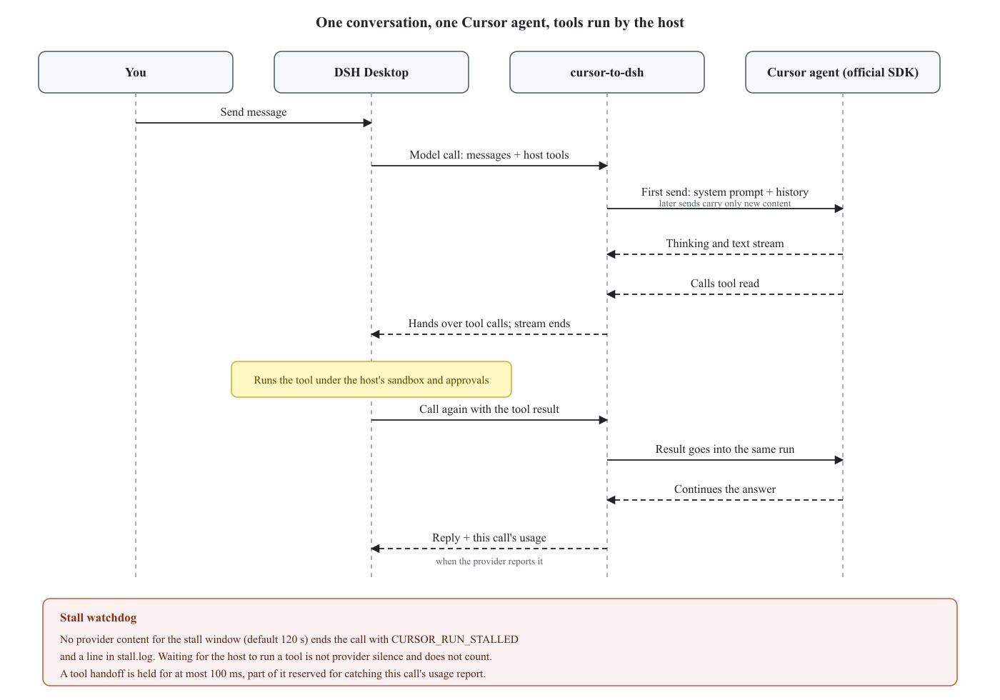

# cursor-to-dsh

[](https://www.npmjs.com/package/cursor-to-dsh)
[](LICENSE)

> Use Cursor models as the `cursor` LLM provider in DeepSeek Harness (DSH) and DeepSeek Desktop, through the official `@cursor/sdk` and your own Cursor API key. DSH keeps the agent loop, tools and permissions; Cursor is only the model.

Register Cursor as a model provider named `cursor` for [DeepSeek Harness](https://github.com/deepseek-ai/deepseek-harness) (DSH, including DeepSeek Desktop). DSH owns the agent loop, tools and permissions; Cursor only provides the model.



## Features

- **Official SDK only**: uses Cursor's `@cursor/sdk` and your own API key. No private protocol, no Cursor IDE session; registered through the host seam `ctx.llm.registerAdapter`, with no host patches.
- **Tools belong to the host**: Cursor's built-in file, shell and edit tools stay off. Reading, writing and running commands happen in DSH, under DSH's sandbox and approvals.
- **Cache reuse**: one Cursor agent per DSH session, and only new content is sent. Tool results return into the same run.
- **Per-call usage**: the provider's usage report for each model turn is what reaches the host, so throughput, token and context meters show what Cursor actually billed for that call.
- **Honest model metadata**: the context window reported to the host is the tier Cursor accepted, including after an automatic step-down, and can be overridden.
- **Stalls are visible**: a run that stops producing content is abandoned with a clear error and a diagnostic, instead of waiting forever.
- **Images**: images in user messages and tool results are forwarded to Cursor.

## Install

Requires DSH `0.2.0-rc.2` or newer (DeepSeek Desktop bundles `0.2.1-rc.2`).

**CLI or any other profile**: `dsh plugin --profile <name> add cursor-to-dsh`.

**DeepSeek Desktop**: the `desktop` profile is managed by the desktop app, and `dsh plugin add` fails with `managed exclusively by the Electron application`. Edit it by hand:

1. Quit DeepSeek Harness Desktop completely.
2. In `~/.dsh/profiles/desktop/package.json`, append two entries without touching the existing ones:

   ```json
   {
     "dependencies": { "cursor-to-dsh": "^0.2.0" },
     "dsh": { "profile": { "bundles": ["…existing entries…", "cursor-to-dsh"] } }
   }
   ```

3. Install with the pnpm the app ships, then start it:

   ```bash
   cd ~/.dsh/profiles/desktop
   node "/Applications/DeepSeek Harness.app/Contents/Resources/runtime/primary-runtime/dependencies/pnpm/bin/pnpm.mjs" install
   open -a "DeepSeek Harness"
   ```

To upgrade, change the version and repeat step 3.

### API key

Create a key at [cursor.com/dashboard](https://cursor.com/dashboard) → API Keys → New API Key (a personal key or a service account key; Team Admin keys are not supported).

The Desktop "Models" settings page cannot store a key for a third-party plugin, so put it in `~/.dsh/.credentials.yaml` (mode `0600`, hot reloaded). If the file already exists, add one line under `refs:`:

```yaml
version: 1
refs:
  CURSOR_API_KEY: <your key>
```

Lookup order: credentials file → `CURSOR_API_KEY` environment variable → plugin `apiKey` config.

### Verify

Cursor appears under Settings → Models, and its models appear under the `cursor` provider. You can also set `agent-default-model` to `provider: cursor`.

### Let an agent install it

Send this to Claude Code, Cursor, pi, or another agent:

```text
Install cursor-to-dsh for my DeepSeek Harness Desktop by following the README at
https://github.com/lukeinx/cursor-to-dsh, obeying the agent rules in it. Tell me where to put
the Cursor API key once it is installed; I will fill in the key myself.
```

Rules for an agent doing the install:

- Quit Desktop before editing the profile; only append entries, never change the existing `dependencies` and `bundles`.
- The user writes the key into the credentials file. The agent must not read or print it.
- Read [AGENTS.md](AGENTS.md) before changing this repository.

## Configuration

The defaults work as they are. To change them, override this plugin's row in the profile's `cordis.patch.yml` (a patch replaces the whole `config`, so write every field you need):

```yaml
- id: llm-cursor
  name: cursor-to-dsh
  config:
    apiKeyEnv: CURSOR_API_KEY
    context: max
    contextWindow: auto
    fast: "off"
    stallTimeoutMs: 120000
```

| Option | Default | Environment override | Meaning |
|---|---|---|---|
| `apiKeyEnv` | `CURSOR_API_KEY` | | Credential / environment variable that holds the Cursor API key |
| `apiKey` | none | | Plain-text key; not recommended |
| `context` | `max` | `DSH_CURSOR_CONTEXT` | Context tier requested from Cursor: `min`, `max`, or an offered value such as `300k`. A rejected tier steps down automatically and the accepted tier is remembered |
| `contextWindow` | `auto` | | Context window reported to the host: `auto` follows the accepted tier, or give a token count such as `400000` |
| `fast` | `off` | | Cursor Fast (priority, higher-cost) mode: `off`, `on`, or `auto` to leave it to Cursor |
| `stallTimeoutMs` | `120000` | `DSH_CURSOR_STALL_TIMEOUT_MS` | Milliseconds without provider content before a run is abandoned; `0` disables the watchdog |
| `cwd` | session working directory | `DSH_CURSOR_CWD` | Cursor agent working directory |

Other environment variables:

- `DSH_CURSOR_DEBUG=1` writes debug lines to stderr.
- `DSH_CURSOR_PREWARM=0` disables warm-up (the plugin pre-builds one agent in the background, saving the Cursor SDK's first ~8 seconds of setup).
- `DSH_CURSOR_STATE_DIR` overrides where the plugin keeps its small persisted files, defaulting to the DSH home (`~/.dsh`). It stores the cached model catalog, the accepted context tier per model, and `stall.log`.

## Known limitations

- File attachments, offloaded images and unreadable images are not forwarded to Cursor; they become a placeholder note. Replaying history carries only the last user message's images.
- Usage is reported per provider turn. When Cursor reports nothing for a call, the host is told nothing for that call; the plugin never invents a number. A report that arrives after its call closed, or before the next call has produced content of its own turn, is discarded instead of being attributed to the wrong call.
- A tool call is handed to DSH within 100 ms. Part of that budget (40 ms) is reserved for catching the turn's usage report, so a slow report can cost the numbers for that call but never delays the tools.
- The reported context window is the tier the plugin requested. If the Cursor account enforces a smaller window than the catalog advertises, the host meter still follows the requested tier.
- `stop` is not supported (`UNSUPPORTED_OPTION`); `temperature` and `maxTokens` are ignored.

## Development

```bash
npm install && npm run build   # the host loads lib/, so rebuild and restart the app after a source change
npm test                       # unit tests with a fake Cursor agent
npm run check                  # type check
npm run check:public           # before pushing to GitHub or publishing: no internal links, local paths or non-English text
CURSOR_API_KEY=... node --experimental-strip-types scripts/live.ts [model]   # real Cursor run
```

The live script prints, for every call, the provider's usage report and how long after the call started it arrived. That is the measurement the per-call usage attribution depends on.

Point Desktop at a local checkout by writing the dependency as `"cursor-to-dsh": "link:<absolute repo path>"`.

Try a run inside a real host without touching your profile (paths in the overlay must be absolute):

```yaml
# /tmp/cursor-overlay.yml
- insert:
    - id: llm-cursor
      name: <absolute repo path>/lib/index.js
- id: agent-default-model
  name: '@deepseek-ai/dsh-agent-default-model'
  config:
    provider: cursor
    model: claude-haiku-5-5
```

```bash
DSH="/Applications/DeepSeek Harness.app/Contents/Resources/runtime/cli/bin/dsh"
CURSOR_API_KEY=... DSH_CURSOR_DEBUG=1 "$DSH" --profile headless --patch /tmp/cursor-overlay.yml --json "Read README.md and summarize it in one line"
```

In the debug log, the call that delivers tool results shows `plan=results`, and the second turn of a conversation shows `plan=send`. A plugin mounted with `--patch` uses its own copy of the host packages, so error codes become `UNKNOWN`; use it for trial runs only.

Architecture and constraints are in [AGENTS.md](AGENTS.md); the sequence diagram source is [docs/images/flow.svg](docs/images/flow.svg).

## License

MIT, see [LICENSE](LICENSE). Copyright (c) 2026 Luke.
